# spritehatch

One pixel-art character, every direction, **same look**.

Plain text-to-image draws each direction as a separate picture, so the front,
side and back come out as different characters. spritehatch fixes that:

1. **One canvas, all views.** The model paints every direction in a single
   image, so outfit and colors stay in sync.
2. **Pose lock.** A chibi OpenPose skeleton per view (head about 40% of the
   height) tells the model which way to face and leaves room for a face at 48px.
3. **Mirror, don't redraw.** One side view is flipped into the other, so the
   two always match. The side that still holds the weapon is the one kept.
4. **Real pixels.** The drawing is shrunk to a 48px sprite: colors are picked
   once for all views (small areas like a face get their own), each sprite
   pixel takes a vote over its block (dark lines count extra, so eyes survive),
   lone specks are removed, speckled shading inside one material is
   flattened (shiny armor reads cleaner) and a 1px outline goes around, painted as a
   dark shade of the color beside it (dark blue by a blue cape), not flat black. Feet sit on the same
   line in every view.

The default model is [Z-Image-Turbo](https://huggingface.co/Tongyi-MAI/Z-Image-Turbo)
(Apache-2.0) on a small 768x320 canvas: its fake pixels keep their size, so a
small canvas gives about as many of them as a 48px sprite can hold, and it
takes about 1.5 minutes on an M1 Pro.

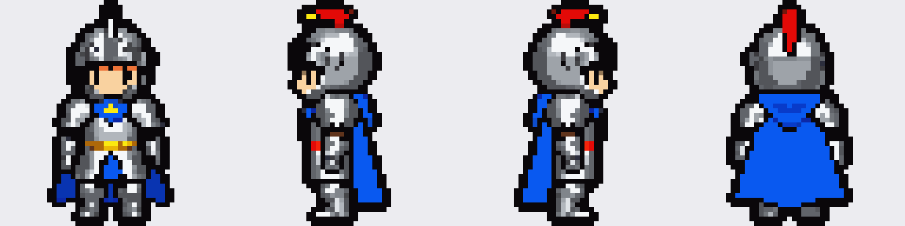

Made with `spritehatch "cute little knight, shiny bright silver armor, blue cape, red
plume on the helmet" --seed 7`. Raw model output: [examples/knight/raw.png](examples/knight/raw.png)

## More characters

Same settings, only the description and seed change (`--seed` in brackets).
Walk, attack and death painted over with `--redraw`.

| archer [5] | rogue [11] | barbarian [2] |
| --- | --- | --- |
| 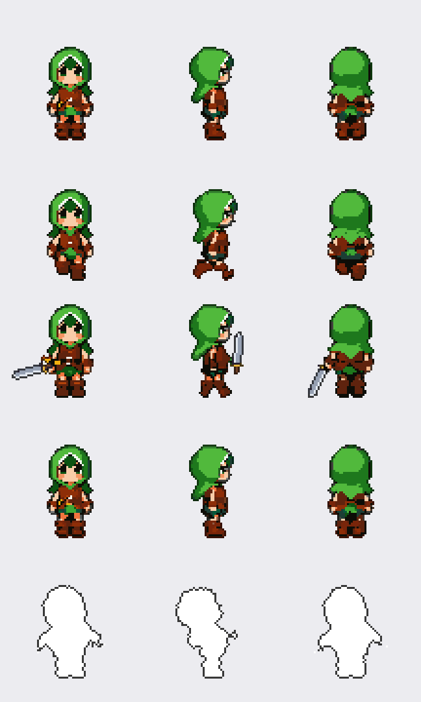 | 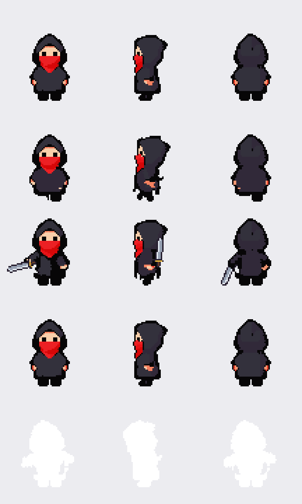 | 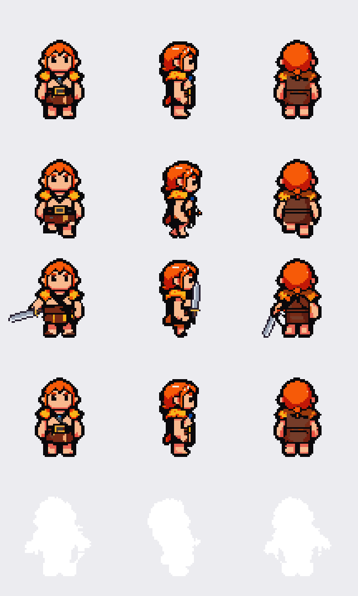 |
| `cute little archer girl, green hood, brown leather vest, short brown boots` | `cute little rogue, black hooded cloak, red scarf over the mouth` | `cute little barbarian, orange braided hair, fur shoulder pads, bare arms` |

## Creatures

`--creature` drops the human body from the prompt and the skeleton from the
motions: creatures squash, hop, lunge and tip over whole (seed 4).

```bash
spritehatch --creature "cute little green slime monster with big eyes" -o out/slime --seed 4
spritehatch-animate out/slime
```

| slime | bat | baby dragon |
| --- | --- | --- |
| 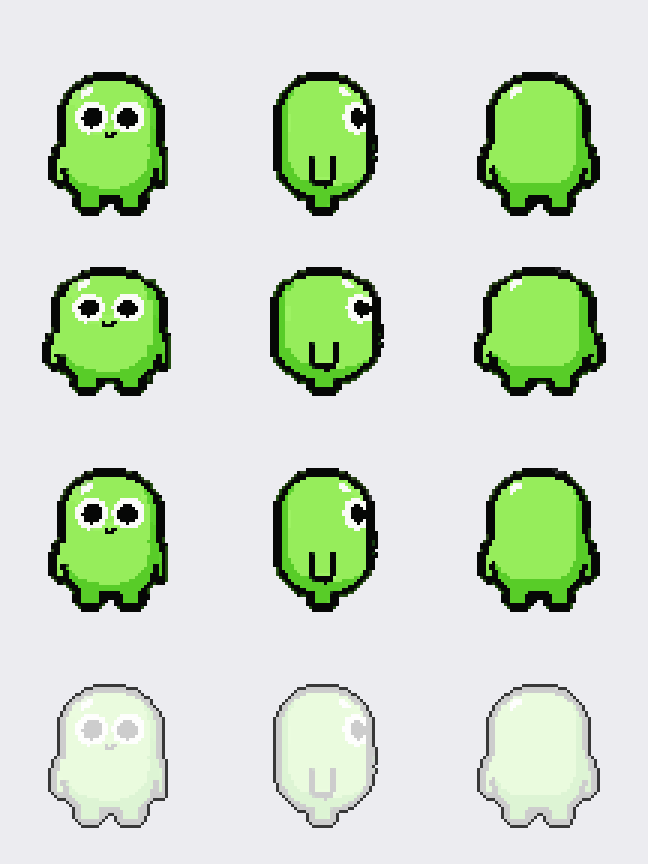 | 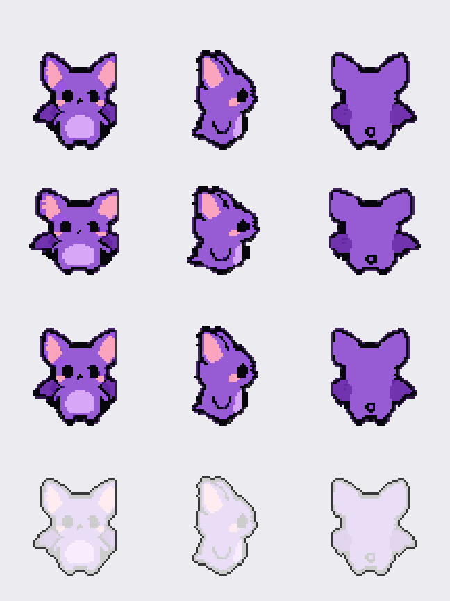 | 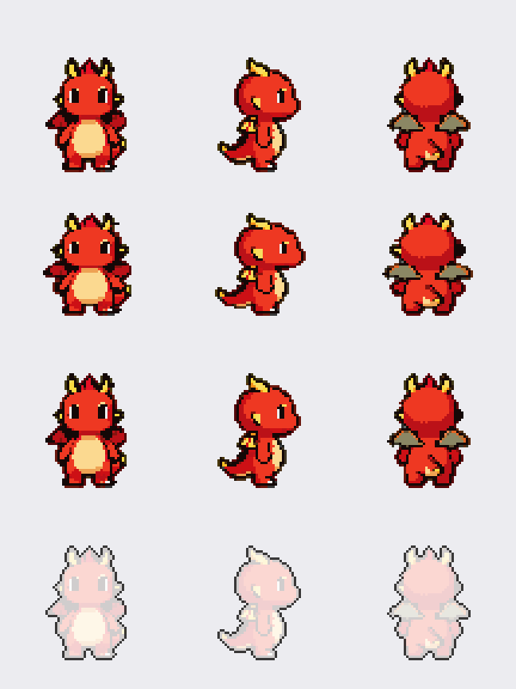 |
| `cute little green slime monster with big eyes` | `cute little purple bat with big ears` | `cute little baby red dragon with small wings, four legs` |

## Bosses

`--boss` makes a 96px boss: a big, menacing body about 4 heads tall (a smaller
head and wider stance in the skeleton, no chibi words in the prompt) on a canvas
twice the size (1536x640, about 5 minutes on an M1 Pro).

```bash
spritehatch --boss "fire demon lord, dark red armor plates, flaming head, glowing orange cracks" -o out/fire --seed 1
spritehatch-animate out/fire
```

| seed | boss |
| --- | --- |
| 1 | 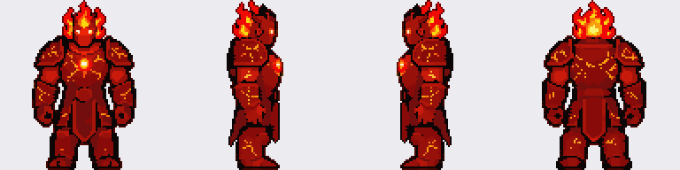 `fire demon lord, dark red armor plates, flaming head, glowing orange cracks` |
| 2 | 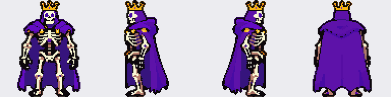 `skeleton king, white bones, golden crown, tattered purple royal cape` |
| 3 | 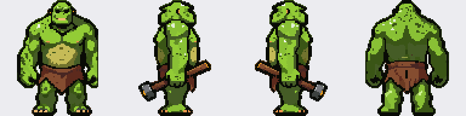 `swamp ogre, bright green skin, big belly, brown loincloth, wooden club` |
| 4 | 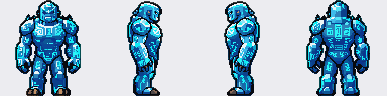 `ice golem made of blue crystal, glowing cyan runes` |

Thin glowing lines (lava cracks, runes) are only a third of a sprite pixel wide
in the drawing and lose every vote when shrunk, so for bosses a sprite pixel
whose block is a quarter to half nearly pure, much brighter color keeps that
glow. The rig treats a boss's arms, legs and torso as thicker (so raised arms do
not tear the chest open) and its sword and magic orb are drawn at twice the size.

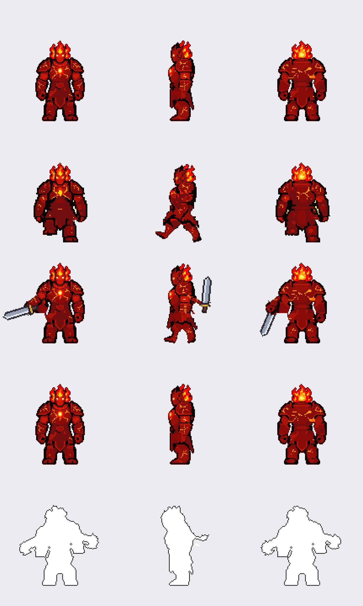

(walk painted over with `--redraw`, the rest straight from the rig)

`--creature --boss` makes a creature boss: a huge, menacing monster without the
human body words, animated whole like the small creatures (the hop and fall
grow with the frame). Wings beat in `idle` and `walk`: when the top half is much
wider than the body below, the columns outside the body slide down and up, more
toward the tips. In profiles the tail (what sticks out behind the body below the
waist) lifts the same way.

```bash
spritehatch --creature --boss "giant red dragon, big wings, horns, four legs, long tail" -o out/dragon --seed 4
spritehatch-animate out/dragon
```

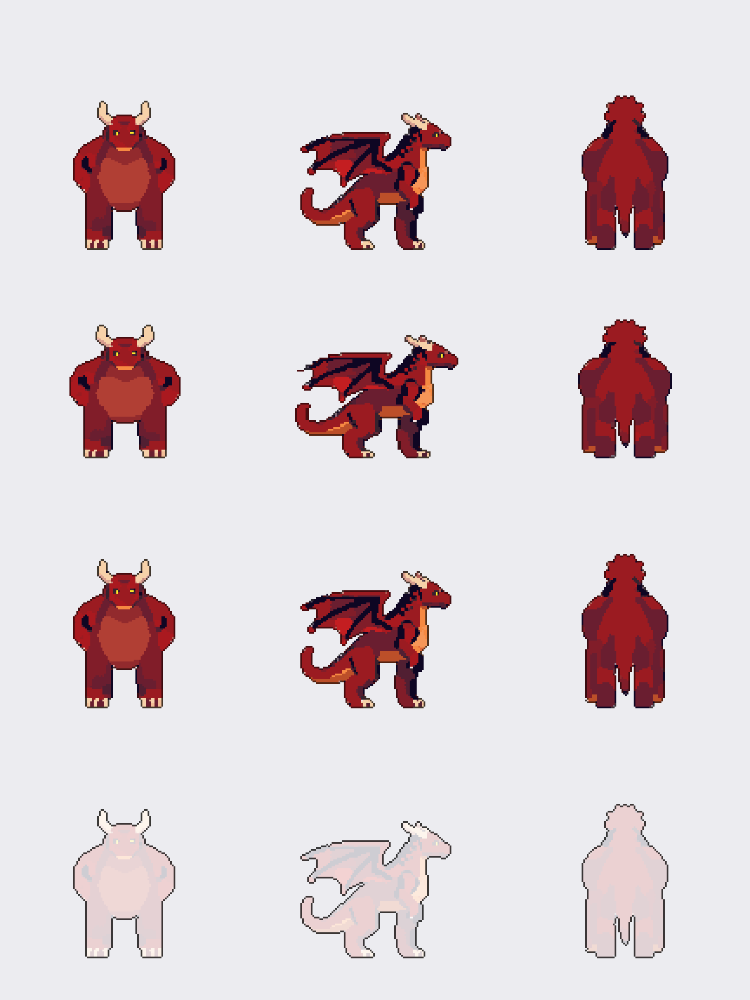

## Motions

```bash
spritehatch-animate out/knight            # idle, walk, attack, cast, death
spritehatch-animate out/knight --motions attack,death
```

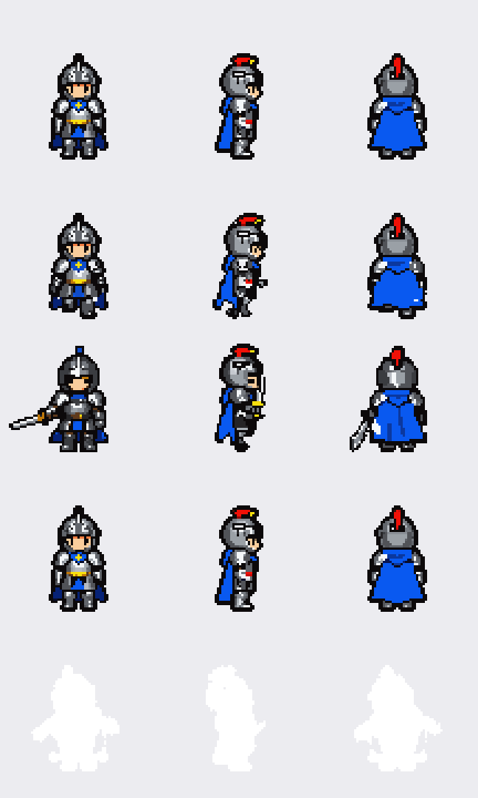

(idle and cast straight from the rig; walk, attack and death painted over with
`--redraw`, see below)

The model was asked to follow a pose skeleton, and that skeleton is saved in
`sheet.json`. `spritehatch-animate` uses it as a 2D bone rig, the way Spine or
DragonBones work:

1. The standing sprite is cut into head, torso, pelvis, upper/lower arms and legs,
   each pixel going to the nearest bone. Pixels far from every arm and leg (a
   cape hem, a wide skirt) stay on the body instead of swinging with a limb.
2. Where an arm covered the torso, the torso gets filled-in pixels so a
   moving arm does not leave a hole.
3. Each motion is a list of joint angles. Parts rotate around their joints,
   parents first, and are drawn back with nearest-pixel sampling, so the art
   stays crisp and keeps its palette. Feet are kept on the floor, and cracks
   that open at bent joints are filled.
4. Sword, slash trail and magic are drawn on top as plain pixels.

No GPU needed, it takes a second.

| motion | frames | what happens |
| --- | --- | --- |
| `idle` | 4 | breathing, arms sway a little |
| `walk` | 8 | legs swing with bending knees, pelvis rocks, arms swing opposite |
| `attack` | 8 | wind-up, swing with a slash trail, follow-through |
| `cast` | 8 | arms rise, an orb grows over the head and is thrown |
| `death` | 8 | hit flash, staggers back, falls flat, lies still |

`attack`, `cast` and `death` use a 1.5x bigger frame so the sword and the fall
fit. Output in `out/knight/anim/`: one sheet per motion (rows: down, left,
right, up), one GIF per motion and direction, and `anim.json` with frame sizes
and timing. Poses live in `spritehatch/moves.py`; add your own there.

Limits: parts are cut from a single drawing, so an arm hidden behind the body
in the side view stays thin, and a cape moves with the torso.

`python -m spritehatch.showcase out/knight/anim` puts every motion into one
GIF like the one above.

### `--redraw`: hand-drawn look

```bash
spritehatch-animate out/knight --motions walk --redraw
```

The rig frames become a rough draft that the model paints over:

1. Four frames of one motion go into one 2x2 image, so they are painted
   together and stay the same character.
2. img2img starts from that draft (`--denoise 0.6`), and an OpenPose grid
   built from the rig's posed joints keeps every limb where the motion wants it.
3. Each cell is shrunk back like the stills and drawn only in the colors of
   the standing sprite.

Bodies lying flat keep their rig frame: the model paints them as a heap of
armor, while the rig frame is the whole standing sprite turned over.

Motions are cut to 4 frames (played slower, so they keep their length). On an
M1 Pro: about 2 minutes per direction for every motion (`--steps 4` halves
that for a quick look, small marks melt). `--model sdxl` uses
SDXL instead.

## Requirements

- [ComfyUI](https://github.com/comfyanonymous/ComfyUI) running locally (default `http://127.0.0.1:8188`)
- Models in ComfyUI for the default Z-Image path (all Apache-2.0, about 22 GB):
  - `diffusion_models/z_image_turbo_bf16.safetensors`, `text_encoders/qwen_3_4b.safetensors`,
    `vae/z_image_ae.safetensors` — [Z-Image-Turbo, ComfyUI repack](https://huggingface.co/Comfy-Org/z_image_turbo)
  - `model_patches/Z-Image-Turbo-Fun-Controlnet-Union-2.1-lite-2602-8steps.safetensors` —
    [Z-Image-Turbo Fun ControlNet Union](https://huggingface.co/alibaba-pai/Z-Image-Turbo-Fun-Controlnet-Union-2.1)
- For `--model sdxl`:
  - `checkpoints/sd_xl_base_1.0.safetensors` — [SDXL base](https://huggingface.co/stabilityai/stable-diffusion-xl-base-1.0)
  - `loras/pixel-art-xl.safetensors` — [Pixel Art XL](https://huggingface.co/nerijs/pixel-art-xl)
  - `controlnet/OpenPoseXL2.safetensors` — [OpenPoseXL2](https://huggingface.co/thibaud/controlnet-openpose-sdxl-1.0)
- Python 3.9+ and a recent ComfyUI (Z-Image nodes)

**Hardware:** tested on an Apple M1 Pro (32 GB): one sheet about 1.5 minutes.
On a Mac, start ComfyUI with `python main.py --gpu-only`. Without it ComfyUI
keeps a CPU and a GPU copy of the models (about 27 GB for Z-Image), the Mac
starts swapping, and a sheet that takes 2 minutes can take over 15.

## Usage

```bash
pip install -e .
spritehatch "cute little knight, silver armor, red cape" -o out/knight
spritehatch-animate out/knight
```

Output in `out/knight/`:

| file | what |
| --- | --- |
| `sheet.png` | all frames in a row, transparent background |
| `frames/<direction>.png` | one file per direction |
| `sheet.json` | frame size and direction order |
| `preview.png` | sheet scaled ×8 for a quick look |
| `raw.png`, `pose.png` | model output and the skeleton it followed |

Options:

- `-d 4` (default): `down, left, right, up`
- `-d 8` (**experimental**): adds diagonals. SDXL often turns three-quarter views
  into plain side views, so expect to try a few seeds.
- `--size 48`: frame size. Default `0` means 48 (96 with `--boss`; with
  `--model sdxl`: the model's own pixel size).
- `--colors 32`: shared palette size.
- `--model sdxl`: the older SDXL path (bigger canvas, grid snapping).
- `--seed N`: repeat a result.
- `--from-raw raw.png`: re-cut an existing image without generating again. Pass the
  real description too: `spritehatch-animate --redraw` reuses it as the prompt.
- `--creature`: a creature, not a person (`spritehatch --creature "cute little
  purple bat with big ears"`). Drops the chibi body words from the prompt, turns
  the skeleton off and swaps the profiles the model draws backwards.
- `--boss`: a 96px boss (see [Bosses](#bosses)). `--size` still overrides the size.
- `--pose-strength 0.8`: how closely the chibi skeleton is followed (`0` = off).
- `--swap-sides`: swap `left` and `right` when the profiles come out facing
  backwards (happens with `--pose-strength 0`).
- `--style-lora file.safetensors` (`--style-strength 0.5`): add a LoRA from
  ComfyUI's `models/loras`, such as one trained on small sprites.

## Limits

- Top-down or bottom-up camera angles and anything beyond 8 directions need a
  real 3D step (image → 3D model → render), which this tool does not do.
- The model sometimes mixes small details between views (a plume here, a belt
  there). Re-roll the seed.
- Weapons: `attack` draws its own sword. If the description already gives the
  character one, there are two; leave the weapon out of the description.
- Creatures (`--creature`) get their own motions without a skeleton: `idle`
  (squash and stretch), `walk` (a hop), `attack` (a lunge) and `death` (tips
  over). No `--redraw` and no `cast` for them.
- Creatures move as one piece except for wings and the tail of a profile (no
  walking legs), wide wings can still touch the edge of their view, and "four legs" still
  comes out standing on two.
- `death` frames halfway down (tipping 30-65 degrees) look rougher than the
  rest.

## License

MIT. Generated images follow the licenses of the models you use.
